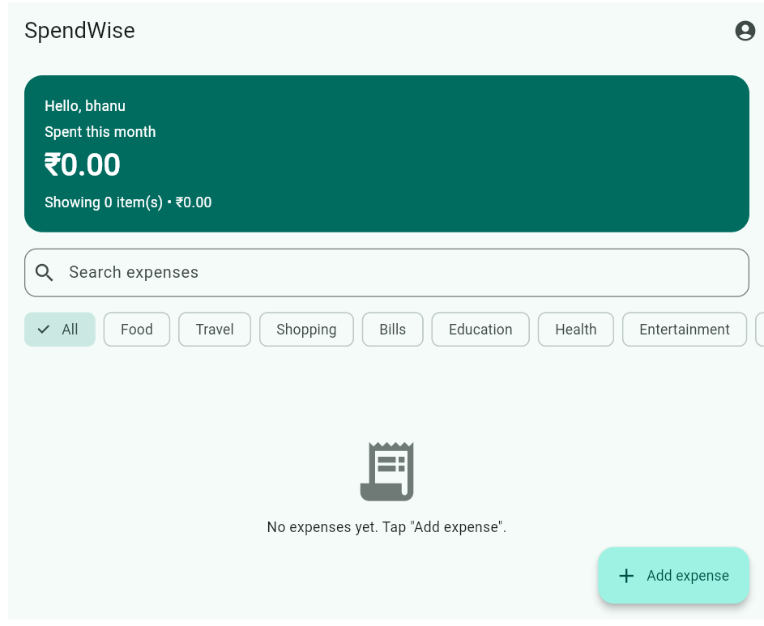
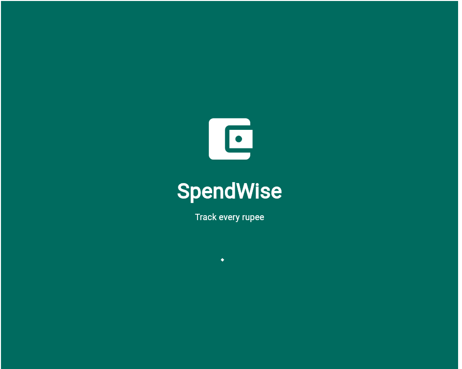
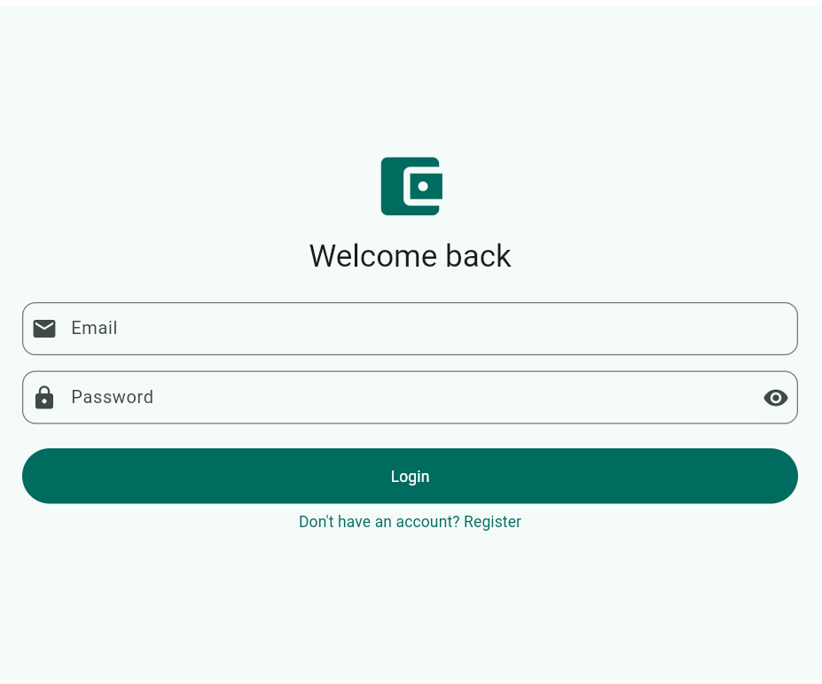
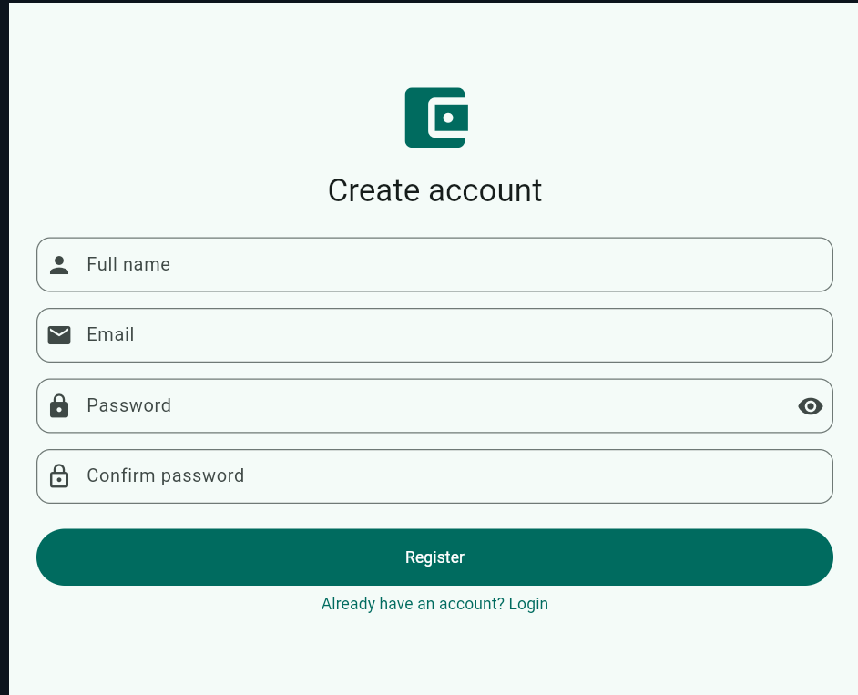
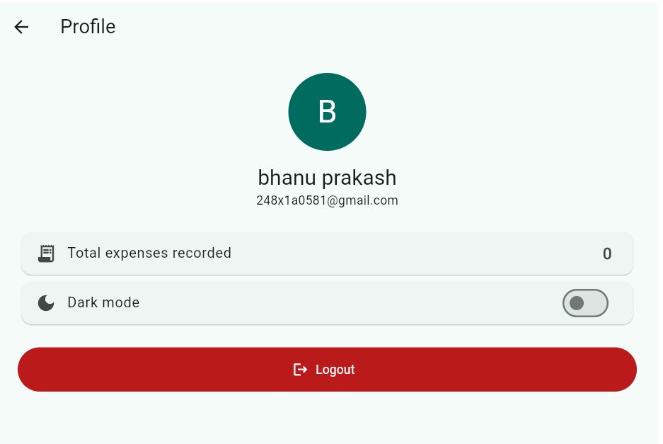

# 💰 SpendWise

**A Flutter-based personal expense tracker** that helps users record, organize and review their daily spending in one simple app. Register, log in, add expenses by category, attach receipt photos, search and filter, and switch between light and dark themes. All data is stored locally on the device, so the app works fully offline.


-00695C)

---

## 📸 Screenshot

<p align="center">
  
</p>

---:|:---:|:---:|
|  |  |  |

| Home Screen | Profile Screen |
|:---:|:---:|
|  |  |

---

## 📖 Project Overview

Keeping track of everyday spending is hard when it lives in memory or scattered notes. SpendWise gives students and individuals a clean, fast way to log every expense, see how much has been spent this month, and find any past entry quickly using search and category filters. Each user has a separate account, and their data stays private on their own device.

---

## ✨ Features

- 🌊 Splash screen with automatic session check
- 🔐 Register and Login with form validation
- 🔒 Passwords stored as SHA-256 hashes (never as plain text)
- 🔁 Persistent login session and Logout
- ➕ Add, ✏️ Edit and 🗑️ Delete expenses (with delete confirmation)
- 📄 Expense detail screen
- 🧾 Receipt photo upload (gallery or camera)
- 🔍 Search expenses by title or note
- 🗂️ Category-wise filtering: Food, Travel, Shopping, Bills, Education, Health, Entertainment, Other
- 📊 Monthly spending summary card on the home screen
- 👤 Profile screen with user info and total expenses recorded
- 🌙 Light and Dark mode switch (saved between launches)
- 🎨 Custom app icon
- 🫙 Empty-state and error handling
- 🎯 Modern Material 3 user interface

---

## 🛠️ Technologies Used

| Technology | Purpose |
|---|---|
| Flutter & Dart | App framework and language |
| Provider | State management |
| shared_preferences | Local data storage |
| image_picker | Receipt photo from gallery or camera |
| intl | Date and currency formatting |
| crypto | Password hashing (SHA-256) |
| flutter_launcher_icons | Custom app icon |

---

## 🧩 Modules

**Authentication Module**
- User registration with validation
- User login and session persistence
- Logout

**Expense Management Module**
- Create, view, update and delete expenses
- Optional receipt photo for each expense

**Search and Filter Module**
- Search by title or note
- Filter by category

**Storage Module**
- Persistent local storage, separate for every user

**Profile and Settings Module**
- User information display
- Expense count
- Dark mode switch
- Logout

---

## 📁 Project Structure

```
lib/
├── main.dart
├── models/
│   ├── app_user.dart
│   └── expense.dart
├── providers/
│   ├── auth_provider.dart
│   ├── expense_provider.dart
│   └── theme_provider.dart
├── theme/
│   └── app_theme.dart
└── screens/
    ├── splash/        splash_screen.dart
    ├── auth/          login_screen.dart, register_screen.dart
    ├── home/          home_screen.dart
    ├── add_expense/   add_edit_expense_screen.dart
    ├── detail/        expense_detail_screen.dart
    └── profile/       profile_screen.dart
assets/icon/           icon.png
screenshots/           app screenshots
test/                  widget_test.dart
```

---

## 🚀 How to Run

**Requirements:** Flutter SDK, and an Android emulator or a physical device.

```bash
# 1. Clone the repository
git clone https://github.com/248x1a0581-star/SpendWise.git
cd SpendWise

# 2. Generate platform folders (first time only)
flutter create .

# 3. Install packages
flutter pub get

# 4. Apply the custom app icon
dart run flutter_launcher_icons

# 5. Run the app
flutter run
```

To build an APK:

```bash
flutter build apk
```

The APK is created at `build/app/outputs/flutter-apk/app-release.apk`. A GitHub Actions workflow (`.github/workflows/build-apk.yml`) can also build the APK online from the **Actions** tab.

---

## 🎯 Objectives

- To provide a simple digital way to record daily expenses
- To help users understand how much they spend each month
- To make old expenses easy to find with search and filters
- To keep user data private by storing it locally
- To provide an easy-to-use and modern application interface

---

## 👍 Advantages

- Simple and easy to use
- Works offline, with no internet needed
- Fast expense entry and lookup
- Private, local data storage
- Light and dark themes
- Lightweight application

---

## 🔮 Future Enhancements

- 📈 Charts for spending by category
- 📤 Export to CSV or PDF
- 💸 Monthly budget limits with alerts
- ☁️ Firebase authentication and cloud sync
- 🔔 Push notification reminders
- 🏷️ Custom categories

---

## 👨‍💻 Developed By

| S.No | Name | Roll Number | Email |
|:---:|---|---|---|
| 1 | **G. Banu Prakash** | 248x1a0581 | 248x1a0581@khitguntur.ac.in |
| 2 | **G. Sivaiah** | 248x1a0580 | 248x1a0580@khitguntur.ac.in |
| 3 | **J. Anil Kumar** | 248x1a0592 | 248x1a0592@khitguntur.ac.in |

---

**SpendWise** — Flutter Personal Expense Tracker
